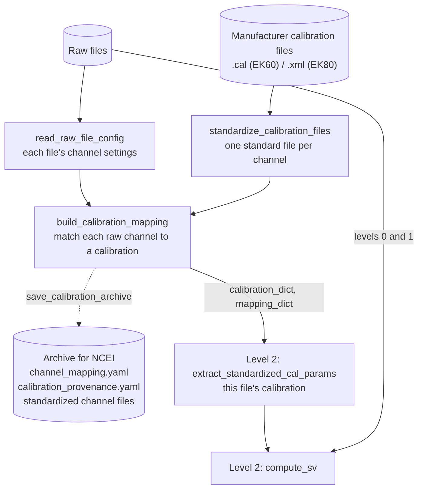

# Calibration

Calibration is a data stream of its own. It starts not from the raw acoustic
files but from the manufacturer's calibration files, one per transducer and
calibration exercise: `.cal` files for the EK60, `.xml` for the EK80. Before
level 2 can apply them, they have to be read, put into one standard form, and
matched to the raw files' channels, which a long survey may run with several
different settings.

The two dictionaries the mapping produces are all level 2 needs:
`calibration_dict` holds the calibration values (gain, Sa correction,
equivalent beam angle, sound speed, absorption, ...) and `mapping_dict` says
which entry belongs to each channel of each raw file. They are passed along in
memory, so a pipeline never reads calibration files back from disk after
building them.

## How a channel is matched

[`build_calibration_mapping`](../ops/build_calibration_mapping.md) matches
each raw channel to the calibration whose settings agree with it: frequency,
pulse length, transmit power and the rest. Matches are exact unless
`tolerances` widens a field. Then:

- **No match**: the channel is left unmapped, and level 2 falls back to the
  calibration the raw file recorded, with a warning
  (`unmapped_channels: error` stops instead).
- **Several matches**: a conflict. `conflict_resolution` decides what happens:
  `error` lists the conflicts and stops, so you delete the calibration files
  you do not want and re-run; `interactive` asks on the terminal; `report`
  returns the conflicts for a caller to resolve with `calibration_choices`,
  which can also average several candidates.

`calibration_provenance.yaml` records, for every channel, which calibration
was applied over which stretch of time and why.

## Where the pipeline can start

From manufacturer calibration files
:   The usual case, and what every recipe on this site does. The stages can
    run as separate, separately cached steps (the pipeline below and the
    [three-phase recipes](phases.md)), or as one step,
    [`generate_standardized_cal_mapping`](../ops/generate_standardized_cal_mapping.md)
    ([one-step recipe](fused.md)).

From standardized calibration files
:   When standardized single-channel files already exist, for example from an
    earlier archive's `Standardized_Reports/`, skip
    `standardize_calibration_files` and point `build_calibration_mapping`'s
    `single_channel_dir` at them.

From the raw files' own values
:   [`compute_sv`](../ops/compute_sv.md) with no `cal_params` uses the
    calibration each raw file recorded when it was collected. The
    [quickstart](../quickstart.md) does this. It needs no calibration files,
    but those values are not the validated calibration.

## Where it joins the processing levels

In both example pipelines the calibration is built in
[level 0](../levels/level-0.md), next to the raw file catalogue whose channel
settings it needs, and applied in [level 2](../levels/level-2.md#calibrated-sv).
Built there it is one more include in a full pipeline; it can just as well be
run on its own first, with the analysis loading its result.

## The complete pipeline on its own

This recipe runs the whole calibration stream for RL2307, an EK80 survey, and
nothing else: it lists the raw files, scans each one's channel settings,
standardizes the calibration files and builds the mapping. Every stage is
cached separately, so a corrected calibration file re-runs only the last two
stages, and an interrupted scan resumes from the files it finished.

--8<-- "data/partials/calibration-staged.md"

The [three-phase recipes](phases.md) split the same steps so a person can
review the standardized channels before the mapping, and archive the result.
